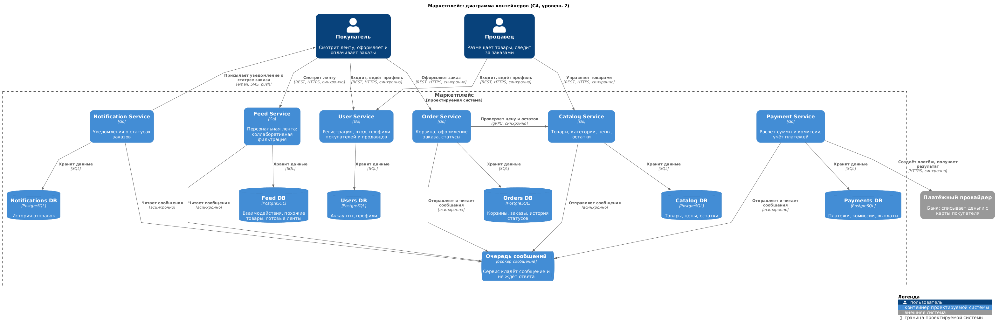

# Архитектура маркетплейса

## C4-диаграмма

Диаграмма контейнеров. На ней сервисы маркетплейса, их базы, очередь сообщений
и связи между ними. Снаружи покупатель, продавец и платёжный провайдер.



## Запуск сервиса

В Docker поднят catalog-service, каркас сервиса каталога. Он написан на Go и
умеет только одно: отвечать 200 OK на GET /health. Бизнес-логики нет, как и
просит задание.

Нужен только Docker:

```bash
docker compose up -d --build
curl -i http://localhost:8080/health
```

Сервис ответит 200 OK с телом ok. В docker-compose.yml настроен health-check,
поэтому через несколько секунд контейнер получит статус healthy:

```bash
docker compose ps
```

Остановить:

```bash
docker compose down
```

В PowerShell вместо curl нужно писать curl.exe.

## Домены

Домены взял прямо из списка функций в задании, получилось шесть.

| Домен | Чем занимается | Чем не занимается |
|---|---|---|
| Пользователи | Регистрация, вход, профили покупателей и продавцов, роли | Заказы, товары, деньги |
| Каталог | Карточки товаров, категории, цены, остатки | Лента, оформление заказа |
| Лента | Подбирает покупателю товары по его просмотрам и покупкам | Не хранит главную версию товара, только копию для показа |
| Заказы | Корзина, оформление заказа, статусы заказа | Приём денег, отправка уведомлений |
| Платежи | Считает сумму и комиссию маркетплейса, проводит оплату через банк, ведёт учёт платежей и выплат продавцам | Статусы заказа |
| Уведомления | Присылает покупателю сообщения о статусе заказа (email, SMS, push) | Не решает, когда уведомлять, а реагирует на сообщения от заказов |

## Сервисы

Делил просто: один домен, один сервис.

| Сервис | Домен | Почему отдельно |
|---|---|---|
| User Service | Пользователи | Про аккаунты знает только он, а нужны они всем |
| Catalog Service | Каталог | Без товаров нет ни ленты, ни заказов |
| Feed Service | Лента | Сюда больше всего запросов, и алгоритм подбора будут часто менять |
| Order Service | Заказы и корзина | Корзина по сути черновик заказа, данные и жизненный цикл у них общие |
| Payment Service | Платежи | Работает с деньгами, то есть с чувствительными данными |
| Notification Service | Уведомления | Работает в фоне, может отправить сообщение чуть позже |

При разбиении смотрел на cohesion и coupling: внутри сервиса всё должно быть
тесно связано, а между сервисами связей поменьше. Поэтому корзина и заказ лежат
вместе в Order Service, а лента ничего не знает об устройстве заказов, ей
приходят только сообщения «статус заказа изменён».

## Кто какими данными владеет

У каждого сервиса своя база, и писать в неё может только он. Остальные
получают эти данные через его API или из сообщений. Общих баз у сервисов нет:
с общей базой получился бы распределённый монолит, где правка таблицы для
одного сервиса ломает другой.

| Сервис | База | Какие данные | За что отвечает |
|---|---|---|---|
| User Service | Users DB | Аккаунты, хэши паролей, профили, роли | Вход, профили, роли |
| Catalog Service | Catalog DB | Товары, категории, цены, остатки | Актуальный ассортимент продавцов |
| Feed Service | Feed DB | Кто что смотрел и покупал, похожие товары, готовые ленты, копия витрины | Подбор ленты |
| Order Service | Orders DB | Корзины, заказы, история статусов | Оформление и статусы заказов |
| Payment Service | Payments DB | Платежи, комиссии, выплаты продавцам | Расчёт и учёт денег |
| Notification Service | Notifications DB | Что и кому отправлено, настройки каналов | Отправка уведомлений |

## Как сервисы общаются

Если ответ нужен прямо сейчас, чтобы продолжить действие пользователя, вызов
синхронный. Если результат может прийти позже, общение асинхронное, через
очередь сообщений.

### Синхронно

| Кто → кому | Как | Зачем |
|---|---|---|
| Покупатель → User, Feed, Order | REST (HTTPS) | Войти, посмотреть ленту, оформить заказ |
| Продавец → User, Catalog | REST (HTTPS) | Войти, управлять своими товарами |
| Order → Catalog | gRPC | При оформлении проверить цену и наличие товара |
| Payment → платёжный провайдер | HTTPS | Создать платёж и узнать, прошла ли оплата |

Снаружи у сервисов REST API, его умеют и браузер, и мобильное приложение.
Между своими сервисами gRPC. Синхронный вызов между сервисами один: он
короткий, а длинную цепочку заказ → оплата → уведомление синхронно делать
нельзя, иначе падение любого звена ломает оформление заказа.

### Асинхронно, через очередь

Очередь работает как почтовый ящик: отправитель кладёт сообщение и идёт
дальше, получатель заберёт его, когда сможет.

| Сообщение | Кто отправляет | Кто читает | Что происходит |
|---|---|---|---|
| «Товар изменён» | Catalog | Feed | Обновить копию витрины |
| «Заказ создан» | Order | Payment | Посчитать сумму и комиссию, создать платёж |
| «Оплата прошла» / «оплата не прошла» | Payment | Order | Отметить заказ оплаченным или отменить |
| «Статус заказа изменён» | Order | Notification, Feed | Отправить уведомление, учесть покупку в ленте |

### Как проходит заказ

1. Order по gRPC проверяет у Catalog цену и наличие, сохраняет заказ и кладёт
   в очередь «заказ создан».
2. Payment создаёт платёж у провайдера, покупатель платит.
3. Payment кладёт в очередь «оплата прошла» или «не прошла», Order отмечает
   заказ оплаченным или отменяет его.
4. Notification присылает покупателю уведомление.

Общей транзакции у заказа и платежа нет, у них разные базы. Поэтому при
неудачной оплате заказ отменяется отдельным шагом.

## Персональная лента

Лента строится коллаборативной фильтрацией: «кто смотрел или покупал этот
товар, тот интересовался и вот этими». Похожесть товаров считается раз в сутки
по истории просмотров и покупок, и покупателю показываются товары, похожие на
те, что он недавно смотрел. Новому покупателю, пока истории нет, показываются
популярные товары и новинки.

## Другие варианты разбиения

Рассмотрел три варианта.

A. Модульный монолит. Одно приложение, которое разворачивается целиком.
Внутри модули по тем же доменам, база одна, но у каждого модуля свои таблицы.

B. Микросервисы по доменам. Шесть сервисов, у каждого своя база, каждый
разворачивается отдельно. Этот вариант нарисован на диаграмме.

C. Разбиение по волатильности. Одни части системы меняются часто, другие
почти не меняются, и границы проводятся по этому признаку. Получается два
сервиса со своими базами: сервис учёта (пользователи, каталог, заказы,
платежи) и сервис инноваций (лента и уведомления). Общаются через очередь.

## Плюсы и минусы вариантов

### A. Модульный монолит

| Плюсы | Минусы |
|---|---|
| Один деплой, легко отлаживать и запускать | Масштабируется только целиком: если не справляется лента, приходится поднимать копии всего приложения |
| Нет сетевых задержек | Ошибка в одном модуле может уронить весь маркетплейс, включая платежи |
| Обычные транзакции: заказ и оплата в одной базе | Платёжные данные в общей базе, доступ к ним ограничить сложнее |
| Дёшево, маленькая команда быстро стартует | Один релиз на всё: изменение ленты требует выкатки всего приложения |

### B. Микросервисы по доменам

| Плюсы | Минусы |
|---|---|
| Каждый сервис выкатывается отдельно: ленту можно менять, не трогая платежи | Нет общих транзакций, отмена заказа при неудачной оплате идёт отдельным шагом |
| Ленту можно масштабировать отдельно | Сеть ненадёжная и с задержками |
| Упали уведомления, а заказы всё равно оформляются | Дороже: шесть баз, очередь, мониторинг |
| Платёжные данные в своём сервисе и своей базе | Нужно следить за контрактами между сервисами |

### C. Разбиение по волатильности

| Плюсы | Минусы |
|---|---|
| Эксперименты с лентой и уведомлениями не трогают учёт | Сервис учёта по сути монолит из четырёх доменов |
| Заказ и оплата в одной базе, обычные транзакции | Платёжные данные лежат вместе с каталогом и пользователями |
| Всего два сервиса и две базы, дешевле, чем B | Каталог и заказы масштабируются только вместе |
| Понятное деление команд: учёт и эксперименты | Лента и уведомления объединены только потому, что обе часто меняются, по смыслу у них мало общего |

## Что выбрал и почему

Выбрал вариант B, микросервисы по доменам.

1. У шести функций из задания разные требования: лента нагруженная и часто
   меняется, платежи работают с деньгами, уведомления могут подождать. В B у
   каждой части своё масштабирование, свои релизы, и падение одной не роняет
   остальные. В A всё это общее, а C разделяет только по частоте изменений.
2. Платежи изолированы: своя база и узкий доступ. Ни A, ни C этого не дают.
3. Уведомления уходят через очередь, и Order Service от них не зависит.
4. Алгоритм ленты целиком внутри Feed Service, его можно менять, не трогая
   остальные сервисы.

Цена выбора: нет общих транзакций, есть сетевые задержки и больше
инфраструктуры. Для маркетплейса с такими разными частями это того стоит. Если
бы команда была из двух-трёх человек и нужна была быстрая первая версия,
разумнее было бы начать с модульного монолита.
